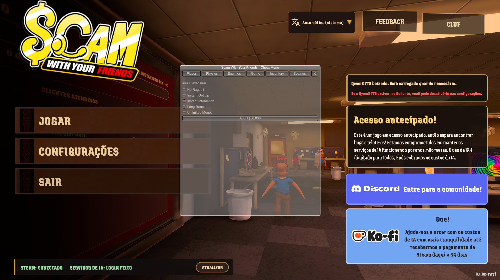

# Unity (Mono Runtime) - In-Game State & Mechanics Menu

Practical proof-of-concept demonstrating reverse engineering and runtime memory/state manipulation on Unity (Mono runtime).

---

## 📌 Preview

---

## 🛠️ Technical Overview
- **Reflection Caching:** Dynamic type resolution (`KolkataOsPlayer`, `ScammerGameManager`, `PlayerInteractor`) with cached lookups to prevent frame drops.
- **Decoupled Execution Loops:** Per-frame updates (`ApplyFrameHacks`) dedicated to physics/movement vectors, while slower checks (inventory, money, game states) run on a 0.5s timer.
- **Input & Engine Integration:** Synchronized with the game's internal `MetaCursor` and `InputBlockers` to ensure mouse release and camera locking while navigating the menu.
- **Localization:** Real-time English and Portuguese UI switching.

---

## 📂 Files
- `menu.cs`: Complete C# source code with Reflection hooks and IMGUI rendering.
- `CheatMenu.dll`: Compiled ready-to-test assembly.
- `image.png`: In-game execution screenshot.
